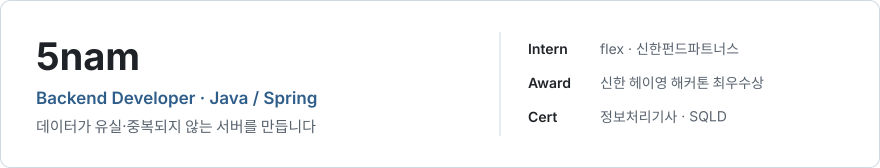

<picture>
  <source media="(prefers-color-scheme: dark)" srcset="assets/header-dark.svg">
  
</picture>

  <picture>
    <source media="(prefers-color-scheme: dark)" srcset="https://skillicons.dev/icons?i=java,spring,mysql,redis,kafka,aws,docker,fastapi&theme=dark">
    
  </picture>

## Projects

<table>
  <tr>
    <td align="center" width="140">
       
      <b>Teaming</b> 팀플 관리 서비스
    </td>
    <td align="center" width="140">
       
      <b>또또가</b> 리뷰 마케팅 플랫폼
    </td>
    <td align="center" width="140">
       
      <b>ClothesMe</b> 시각장애인 의류 어시스턴트
    </td>
    <td align="center" width="140">
       
      <b>니어니어</b> 세대를 잇는 음식 주문 서비스
    </td>
    <td align="center" width="140">
       
      <b>matchday</b> 스포츠 동아리 일정·매치 서비스
    </td>
    <td align="center" width="140">
       
      <b>혜택알려조</b> 대학생 제휴 혜택 플랫폼
    </td>
  </tr>
</table>

 팀플 관리 서비스 | **또또가** 리뷰 마케팅 플랫폼 | **ClothesMe** 시각장애인 의류 어시스턴트 | **니어니어** 세대를 잇는 음식 주문 서비스 | **matchday** 스포츠 동아리 일정·매치 서비스 | **혜택알려조** 대학생 제휴 혜택 플랫폼 |

 

## Experience
| 기간 | 활동 명칭 | 상세 내용 |
| :--- | :--- | :--- |
| 2026.09 - 2026.10 | **신한펀드파트너스 인턴** | ProFrame·Pro*C 기반 펀드회계 조회 화면 개발, 테스트 내역서 작성 AI 에이전트 개발 |
| 2026.01 - 2026.07 | **flex Enterprise Product Engineer 인턴** | 패스키(WebAuthn) 인증 도입, 채용 지원자 검색을 DB에서 검색엔진으로 운영 전환 |
| 2025.07 - 2025.12 | **SSAFY 14기 (삼성청년SW·AI아카데미)** | 1학기 수료(925시간). Java·Spring Boot·MyBatis·REST API, Vue.js, SQL·DB 모델링, 알고리즘, 생성형 AI·LangChain Agent 학습 AI 관통 프로젝트 **플레잇(Playt)** - AI 여행지 추천 서비스 |
| 2024.03 - 2024.08 | **UMC 6기** | 서버(Spring Boot) 파트장, 백엔드 스터디장 |
| 2023.09 - 2024.02 | **UMC 5기** | 서버(Spring Boot) 파트 수료 |
| 2023.03 - 2023.08 | **UMC 4기** | 서버(Spring Boot) 파트 수료 |

 

## Honors & Awards

| 날짜 | 수상 명칭 | 수여 기관 | 비고 |
| :--- | :--- | :--- | :--- |
| 2025.08 | **2025 신한 헤이영 해커톤 최우수상** | 신한은행 | 대학생 제휴 혜택 플랫폼 혜택알려조 (BE) |
| 2025.01 | **헐트 프라이즈 교내 예선 최우수상** | 교내 | 세대를 잇는 음식 주문 서비스 니어니어 (BE 팀장) |

 

## Certifications & Language
| 구분 | 자격 및 어학 명칭 | 발급 기관 / 성적 | 취득일 |
| :--- | :--- | :--- | :--- |
| **Tech** | **정보처리기사** | 한국산업인력공단 | 2024.12.11 |
| **Tech** | **SQL 개발자 (SQLD)** | 한국데이터산업진흥원 | 2023.12.15 |
| **Tech** | **ITQ 아래한글 A등급** | 한국생산성본부 | 2015.07.30 |
| **Tech** | **GTQ 그래픽기술자격 1급 (포토샵)** | 한국생산성본부 | 2015.03.20 |
| **Tech** | **ITQ 한글엑셀 B등급** | 한국생산성본부 | 2013.10.02 |
| **Tech** | **ITQ 인터넷 A등급** | 한국생산성본부 | 2012.12.13 |
| **Tech** | **ITQ 한글파워포인트 A등급** | 한국생산성본부 | 2012.05.31 |
| **Language** | **OPIc English** | **Intermediate High (IH)** | 2026.09.11 |

